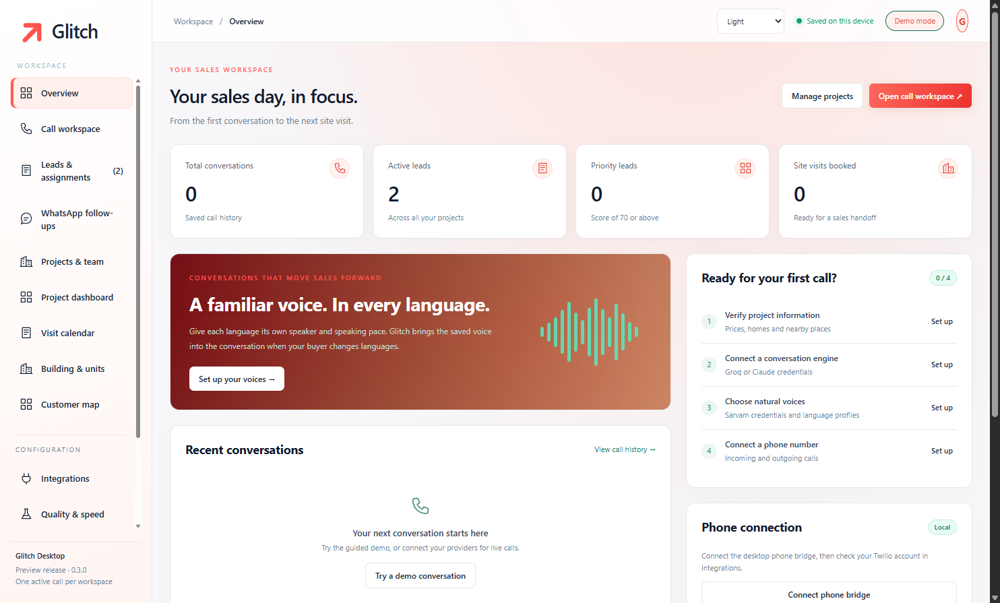

# Glitch

**A desktop sales workspace for real estate developers.**

Glitch combines multilingual lead qualification, project campaigns, relationship-manager assignments, site visits, building inventory and customer-location insights in a Windows application.

**Version 0.3.0 · installable pilot.** Local operation, one active call at a time, separately configured service providers. This is not yet a hosted, multi-tenant SaaS product.

## Features

| Workspace | Capabilities |
| --- | --- |
| Calling | Scripted demo, Groq/Claude conversation modes, Sarvam speech, Twilio inbound/outbound integration, saved language speakers and pace |
| Leads and team | Project knowledge, qualification scorecards, customer history, RM assignment, reporting managers and contact details |
| Campaigns | Excel/CSV preview and import, duplicate checks, consent confirmation, daily limits, calling windows, sequential dialing and uncertain-call review |
| Reports | Project KPIs, linked Excel project sheets, HTML dashboard, daily 18:30 Asia/Kolkata generation and scoped email through Resend |
| Calendar | Monthly tiles, customers and times, blocked dates, opening hours, per-slot limits and weekday maximums |
| Building and units | GLB/glTF/OBJ import, white studio view, orbit/zoom, geometry selection and colour-coded availability |
| Customer map | Pincode/landmark capture, confirmed pins, demand heatmap, optional Geoapify search and exact-pincode resolution |
| Operations | WhatsApp follow-ups, configurable CRM integration, diagnostics, portable exports and encrypted database backups |

Emerald/orange and light/coral themes follow the supplied UI references. KPIs use saved activity; the UI does not display invented sales results.

## Run from source

Requires Windows x64, Node.js 24 and pnpm. Customers using the installer do not need Node.js.

~~~powershell
pnpm install --ignore-scripts
node node_modules/electron/install.js
node download.cjs
node licenses.cjs
pnpm test
pnpm start
pnpm dist
~~~

The build outputs **release/Glitch-Setup-0.3.0.exe**. Three.js, Leaflet and the spreadsheet library are bundled. The download script fetches the pinned Cloudflare helper and spreadsheet bundle. Enter service credentials inside the application; no keys belong in source control. The pilot installer is unsigned.

## Documentation

- [Setup](docs/SETUP.md)
- [System design](docs/ARCHITECTURE.md)
- [Data model](docs/DATA_MODEL.md)
- [Operations and bug fixes](docs/OPERATIONS.md)
- [Tests and limitations](docs/TESTING.md)
- [Commercial roadmap](docs/ROADMAP.md)
- [Portfolio write-up](docs/PORTFOLIO.md)
- [Publishing this project on GitHub](docs/GITHUB.md)
- [Security](SECURITY.md), [contributing](CONTRIBUTING.md), [changelog](CHANGELOG.md) and [third-party notices](THIRD_PARTY_NOTICES.md)

## Structure

~~~text
app/          UI, conversation engine, workflows, brand and vendor assets
desktop/      Electron shell, protected storage, bridge, reporting, model import
test/         Unit and service tests with synthetic data
samples/      Synthetic building and import examples
docs/         Setup, design, operations, screenshots and evidence
qa*.cjs       Isolated Electron integration tests
~~~

## Current boundaries

Glitch and the computer must stay running for scheduled work. Admin roles describe routing and reporting relationships; they are **not authenticated multi-user access controls**. Map updates are local, checked every two seconds after confirmed records change; this is not GPS tracking. Model geometry is retained, with a 1 GB package limit and practical GPU/memory limits. AI visit requests require a specific slot confirmed in the calendar.

Live calling, email delivery, automatic geocoding and installation under a normal Windows account require the acceptance checks in the testing guide. Automated tests do not establish real-world voice latency, commercial outcomes or provider uptime.

No open-source licence has been selected for the application code. Choose one before granting reuse rights or accepting contributions. Third-party components retain their own licences.
